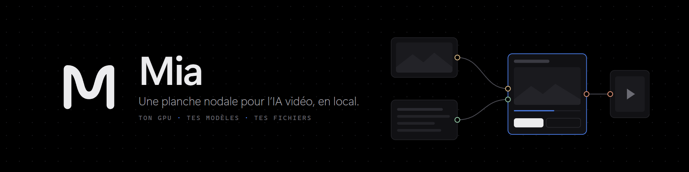
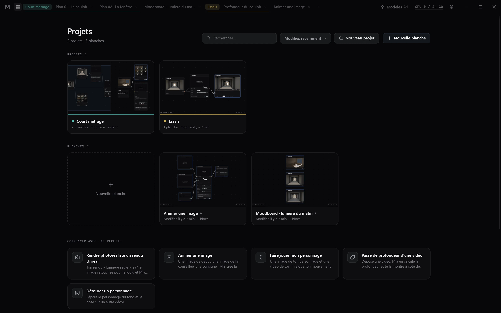
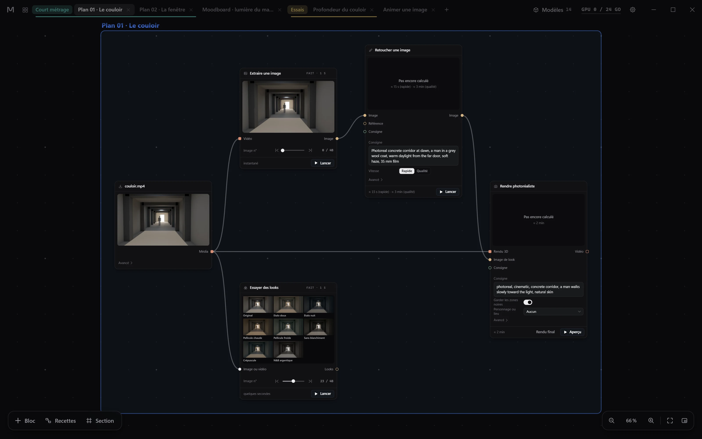
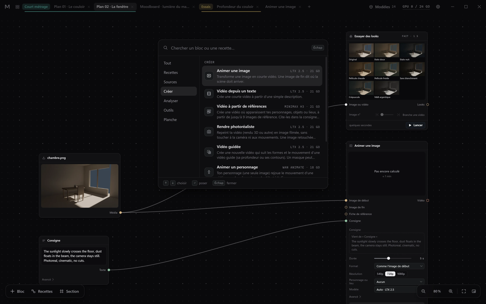
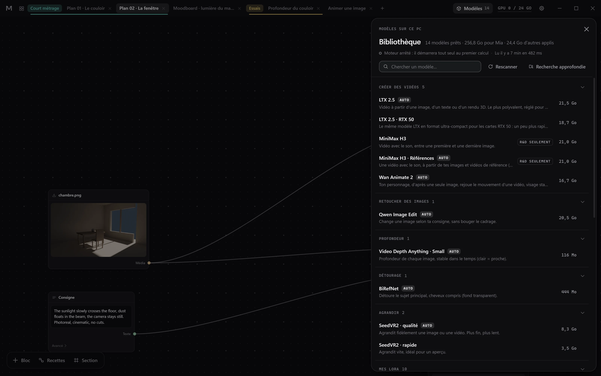
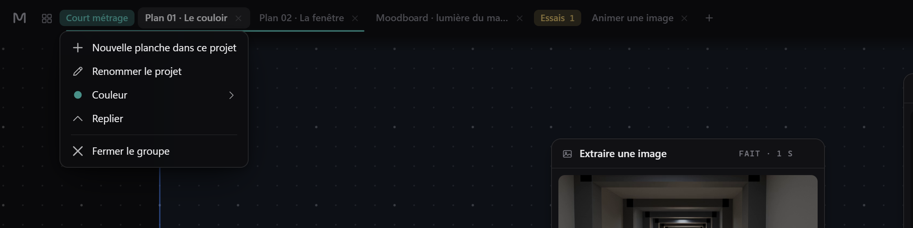

<div align="center">
  
</div>

<div align="center">

[](CHANGELOG.md)
[](LICENSE)
[](https://www.electronjs.org/)
[](docs/INSTALL.md)
[](docs/INSTALL.md)

</div>

**Mia est une planche nodale pour faire de la vidéo et de l'image avec l'IA, entièrement sur son propre PC.** On
dépose images, vidéos et sons sur une planche noire infinie, on les relie à des blocs nommés par ce qu'ils font
(*Animer une image*, *Profondeur*, *Rendre photoréaliste*), on choisit le modèle, on lance, et le résultat se lit
dans le bloc. Ni compte, ni graphe de soixante nœuds : Mia pilote ComfyUI et un petit worker Python à votre place,
un calcul GPU à la fois. Des modèles en ligne sont là aussi, seulement si vous reliez votre propre compte.

**[Installer](docs/INSTALL.md)** · **[Journal des versions](CHANGELOG.md)** · **[Architecture](docs/ARCHITECTURE.md)** ·
**[Assistants (MCP)](mcp/README.md)** · **[Skills](skills/README.md)** · **[English](README.md)**

<div align="center">
  
</div>
<p align="center"><em>Claude monte le plan par le serveur MCP de Mia, sous vos yeux : une maquette 3D et sa première image retouchée, <b>Rendre photoréaliste</b>, câblage, lancement, puis un volet avant/après. L'aperçu d'une minute est raccourci ici.</em></p>

### Nouveau dans la 0.7

<div align="center">
  <a href="CHANGELOG.md"></a>
</div>
<p align="center"><em>Un projet range des planches ; ses onglets restent ensemble, à sa couleur, comme les groupes d'onglets de Chrome.</em></p>

- **Fluide sur les grandes planches** : sur une planche de 110 blocs, taper une consigne, ouvrir la planche, s'y
  déplacer et tirer des fils ne traînent plus ; le zoom à la molette saccade moins.
- **Un seul bouton « Générer »** sur chaque bloc, avec à côté le temps prévu, appris de vos propres calculs sur ce
  PC.
- **Agrandir, deux nouvelles façons** : « NVIDIA RTX · express » (quelques secondes à quelques minutes, rien
  d'inventé) et « LTX · détails » (1440p ou 4K, le détail fin recréé, fidèle au cadrage et au style).
- **Modèles en ligne : le prix avant de lancer** : chaque bloc en ligne affiche son prix, « + Bloc » montre « dès
  … $ », et le coin de la planche ce qui reste de votre budget Higgsfield.
- **Choisir un modèle et « + Bloc », refaits** : recherche, favoris (une étoile, Ctrl+D, Alt+1 à 9), derniers
  choisis en tête, une ligne courte par entrée, la description complète de celle qu'on parcourt, et quand choisir
  chaque modèle en ligne.
- Depuis la 0.6 : un bloc par modèle, des modèles en ligne par votre propre compte Higgsfield, des images sur votre
  PC (FLUX.2 Klein 9B, Qwen-Image 2.1 Turbo), retoucher une zone dans un bloc **Masque**, réécrire une consigne en
  anglais, 4 variantes.

[Ce que fait Mia](#ce-que-fait-mia) · [Blocs](#blocs) · [Modèles](#modèles) · [Installer](#installer) ·
[Utiliser](#utiliser) · [Assistants](#assistants) · [Licence et crédits](#licence-et-crédits)

---

## Ce que fait Mia

<div align="center">
  
</div>
<p align="center"><em>Un plan dans sa section : un blockout 3D, sa première image extraite puis retouchée pour le look, <b>Rendre photoréaliste</b> prêt pour un aperçu, et tous les looks de la Finition essayés sur une image. Les vidéos se lisent dans leur bloc, image par image.</em></p>

Mia est faite pour celles et ceux qui fabriquent des films et des images avec des modèles locaux et veulent penser
en plans, pas en graphes.

- **Une planche, pas un éditeur de graphes.** Des blocs nommés par ce qu'ils font, les réglages avancés repliés, des
  fils qui tombent pile sur leurs pastilles, des sections pour cadrer un plan. Souris et trackpad, minicarte, rien de
  Windows à l'écran.
- **Aperçu, puis rendu final.** Chaque calcul est une version de son bloc ; l'étoile en épingle une pour la suite.
  Un bloc dont les réglages ou l'amont ont changé le montre, et relancer un bloc ne recalcule que ce qui a changé.
- **Un seul gros calcul à la fois.** Une file unique et un verrou GPU partagé avec les autres outils de la machine ;
  l'heure de fin s'apprend de vos propres calculs (« fin vers 20 h 45 »).
- **Un lecteur précis à l'image** dans chaque bloc vidéo : compteur d'images, pas d'une ou dix images, vitesse,
  extraire l'image courante dans un nouveau bloc.
- **Vos LoRA** : glisser un `.safetensors` sur Mia, le nommer, régler sa force ; son mot déclencheur est ajouté tout
  seul à la consigne.
- **Des assistants sur la planche** : Claude ou Codex construisent une planche par le serveur MCP de Mia, sous vos
  yeux (un curseur à leur nom pose et relie les blocs). Chaque action s'annule avec Ctrl+Z.
- **Le local d'abord.** Mia n'écoute que `127.0.0.1`. Elle ne va sur Internet que pour les téléchargements de
  modèles que vous lancez et, si vous reliez un compte Higgsfield, pour les calculs en ligne que vous lancez et pour
  afficher ce que le compte a dépensé.

<div align="center">
  
</div>
<p align="center"><em>Ajouter un bloc (<b>Tab</b>), tirer un fil, écrire la consigne, lancer l'aperçu : la maquette grise devient une chambre au soleil. La retouche de 31 secondes est raccourcie ici.</em></p>

<div align="center">
  
</div>
<p align="center"><em>Le lecteur de chaque bloc vidéo : lecture, pause, image par image, compteur en images ou en secondes, puis <b>Extraire cette image</b> en fait un bloc image.</em></p>

<div align="center">
  
</div>
<p align="center"><em>La palette : catégories, recherche, et le modèle que chaque bloc utilisera.</em></p>

<div align="center">
  
</div>
<p align="center"><em>La bibliothèque : les modèles trouvés sur ce PC, décrits par ce qu'ils savent faire, avec leur taille et leur licence.</em></p>

<div align="center">
  
</div>
<p align="center"><em><b>Essayer des looks</b> passe une image par tous les looks « film » ; dans <b>Finition › Étalonnage</b>, chaque look choisi devient une nouvelle version du bloc.</em></p>

<div align="center">
  
</div>
<p align="center"><em>Onglets groupés : la couleur d'un projet, son menu, et un projet replié à droite.</em></p>

Les captures et les animations utilisent de simples blockouts 3D rendus pour cette page ; les résultats sont de vrais aperçus calculés par Mia sur une seule carte graphique.

---

## Blocs

| Catégorie | Bloc | Ce qu'il fait | Calcul |
|---|---|---|---|
| Sources | **Média** | Une image, une vidéo ou un son du PC | — |
| | **Consigne** | Un texte qui dit à l'IA quoi montrer ou faire | — |
| Planche | **Note** | Une note pour soi sur la planche | — |
| Créer | **Modèle** | Un bloc par modèle, sur ce PC ou en ligne : ses entrées sont celles du modèle, ce qu'on branche décide de ce qu'il fait (vidéo, image, retoucher une zone…) | GPU, ou en ligne |
| | **Animer une image** | Une image devient une courte vidéo ; une image de fin dit où le plan doit arriver | GPU |
| | **Vidéo depuis un texte** | Une courte vidéo à partir d'une simple description | GPU |
| | **Vidéo à partir de références** | Une vidéo avec vos personnages, objets ou lieux, d'après jusqu'à 9 images | GPU |
| | **Rendre photoréaliste** | Repeint un rendu 3D en image filmée, caméra et mouvements gardés | GPU |
| | **Vidéo guidée** | Une nouvelle vidéo qui suit la profondeur ou les contours d'une vidéo guide | GPU |
| | **Animer un personnage** | Votre personnage, d'après une image, rejoue le mouvement d'une vidéo | GPU |
| | **Retoucher une image** | Change une image selon la consigne, cadrage gardé | GPU |
| | **Agrandir** | Plus de définition, détails recréés, mouvement intact | GPU |
| Analyser | **Profondeur** | La profondeur de chaque image, sans scintillement (clair = proche) | GPU |
| | **Détourer** | Sépare le sujet principal du fond | GPU |
| Outils | **Masque** | Peindre sur une image la zone à changer (ou à protéger) | processeur |
| | **Comparer A/B** | Deux images ou vidéos côte à côte, lues ensemble | — |
| | **Extraire une image** | Une image exacte d'une vidéo | instantané |
| | **Couper** · **Redimensionner** · **Assembler** | Couper, recadrer, mettre des plans bout à bout dans l'ordre des fils | NVENC, sinon processeur |
| | **Superposer** | Un calque sur un fond, à travers un masque | GPU |
| | **Son** | Ajoute une musique ou un bruitage, mélangé au son d'origine ou à sa place | NVENC, sinon processeur |
| | **Finition** | Étalonnage par LUT, grain et vignettage, son gardé | GPU |
| | **Essayer des looks** | Une image passée par tous les looks de la Finition, en planche contact | processeur |
| | **Exporter** | Range le résultat dans le dossier « à regarder » de la planche, au bon format | NVENC, sinon processeur |

Sept **recettes** démarrent une planche déjà câblée : *Rendre photoréaliste un rendu Unreal*, *Animer une image*,
*Vidéo à partir de mes références*, *Faire jouer mon personnage*, *Passe de profondeur d'une vidéo*, *Retoucher une
zone*, *Détourer un personnage*. Une **Consigne** peut d'abord réécrire son texte en anglais sur votre PC
(*Réécrire en anglais*). Le catalogue est dans [`src/catalog/nodes.json`](src/catalog/nodes.json).

---

## Modèles

Mia **n'embarque aucun modèle**. Elle parcourt le dossier du moteur, reconnaît ce qui s'y trouve et le présente par
ce qu'il sait faire ; ce qui manque s'installe depuis la bibliothèque.

| Capacité | Modèle utilisé par Mia | Licence (telle que signalée dans Mia) | Mémoire GPU (pic) |
|---|---|---|---|
| Animer une image, vidéo depuis un texte, rendre photoréaliste, vidéo guidée | LTX 2.5 (int8 ; NVFP4 sur RTX 50) | [LTX-2.x Community License](docs/licenses/LTX-2.x-Community-License.txt) : usage commercial gratuit sous 10 M$ de chiffre d'affaires | ~21 Go |
| Animer une image (avec le son), vidéo à partir de références, vidéo guidée | MiniMax H3, MiniMax H3 Références | R&D seulement | ~21 Go |
| Animer un personnage | Wan Animate 2 | Apache-2.0 | ~18 Go |
| Retoucher une image | Qwen Image Edit | Apache-2.0 | ~21 Go |
| Image depuis un texte, retoucher une zone | FLUX.2 Klein 9B · Qwen-Image 2.1 Turbo | FLUX Non-Commercial · licence de recherche Qwen : proposés « à essayer », pour des essais et des projets perso | ~22 / ~17 Go |
| Réécrire une consigne en anglais | le lecteur de texte de Qwen-Image 2.1 (Qwen3-VL 8B), sinon celui de Qwen Image Edit | celle de son modèle | ~10 Go |
| Agrandir | SeedVR2 7B (qualité), 3B (rapide) | Apache-2.0 | 12 / 7 Go |
| Profondeur | Video Depth Anything Small | Apache-2.0 | ~3 Go |
| Détourer | BiRefNet | MIT | ~2 Go |
| Personnage ou lieu | Vos LoRA pour LTX, Wan, Qwen, FLUX.2 Klein ou Qwen-Image 2.1 | les vôtres | — |
| En ligne, au choix | Seedance, Kling, MiniMax 2K, Soul… par votre compte Higgsfield | leurs conditions, payant à chaque calcul | aucune |

Les deux IC-LoRA de la vidéo guidée et des fiches de référence (Union-Control, Ingredients) sont des fichiers
LTX-2.3, sous la [LTX-2 Community License](docs/licenses/LTX-2-Community-License.txt) de janvier 2026, avec le même
seuil de 10 M$.

MiniMax H3 est proposé avec la mention **R&D seulement**. Les modèles dont la licence est non commerciale ou exclut
l'Union européenne sont reconnus mais **jamais proposés** dans un bloc, sauf FLUX.2 Klein 9B et Qwen-Image 2.1 :
ils sont proposés « à essayer », avec un avertissement « non commercial » sur le bloc. Ces indications aident à choisir ; elles ne valent pas avis juridique : lire la fiche de chaque modèle
avant un travail payé.

---

## Installer

**Il faut** Windows 10 ou 11 (64 bits) ; une carte NVIDIA avec un pilote 580 ou plus récent, de 12 Go de mémoire
pour la profondeur, le détourage et l'agrandissement rapide, de 24 Go pour les modèles vidéo et la retouche
d'image ; environ 15 Go de disque pour le moteur et 20 à 150 Go pour les modèles ; Internet pendant l'installation
seulement. Le pas à pas complet : [docs/INSTALL.md](docs/INSTALL.md).

1. **Mia.** Prendre l'installateur ou le zip portable sur la page Releases, ou la lancer depuis les sources :

   ```powershell
   git clone https://github.com/Quentincls/mia.git
   cd mia
   npm install
   npm start
   ```

   Les versions ne sont pas encore signées : SmartScreen demande une confirmation la première fois.

2. **Le moteur.** Au premier lancement, l'assistant propose de reprendre un ComfyUI déjà installé ou d'installer le
   moteur de Mia dans le dossier de son choix. Le même script se lance aussi à la main ; `-DryRun` montre chaque
   étape sans rien télécharger :

   ```powershell
   powershell -NoProfile -ExecutionPolicy Bypass -File engine-setup\install-engine.ps1 -Target "D:\Mia-moteur" -DryRun
   ```

3. **Les modèles.** Ouvrir la bibliothèque (**Modèles**, en haut à droite), puis **Installer** à côté d'un modèle
   manquant, ou **Tout installer pour** une capacité. Pour un modèle à licence à accepter : l'accepter sur Hugging
   Face, puis `hf auth login` une fois ; Mia lit ce jeton sans jamais le garder.

---

## Utiliser

1. **Nouvelle planche** (Ctrl+N), ou une recette sur l'accueil.
2. **Glisser** des images, vidéos ou sons sur la planche. Un fichier LoRA lâché n'importe où ouvre *Ajouter un LoRA*.
3. **Ajouter un bloc** avec **Tab** (ou le bouton **+ Bloc**) et relier une sortie à une entrée.
4. **Aperçu** d'abord, puis **Rendu final**. Le résultat s'affiche dans le bloc ; les calculs précédents restent en
   versions.
5. **Exporter** écrit le fichier final dans le dossier `A_regarder` de la planche.

| Touches | Action |
|---|---|
| Molette · pincer | Zoom au curseur |
| Clic molette · Espace + glisser · deux doigts | Déplacer la vue |
| Tab | Ajouter un bloc |
| S · Ctrl+G | Dessiner une section · section autour de la sélection |
| F · M | Tout voir · minicarte |
| Ctrl+Z · Ctrl+Y | Annuler · rétablir |
| ← → · Maj+← → | Image précédente / suivante · dix images |
| , . | Plus lent · plus vite |
| Ctrl+N · Ctrl+Maj+N | Nouvelle planche · nouveau projet |
| Ctrl+Tab · Ctrl+W | Onglet suivant · fermer l'onglet |

Les planches vivent dans `D:\Mia\Projets` si un disque D: existe, sinon dans `Documents\Mia Projets` (modifiable
dans les Réglages). Chaque planche est un simple dossier : `graph.json`, `media\` (les originaux, jamais
recompressés), `outputs\<bloc>\<calcul>\` (chaque résultat avec son `run.json`), `A_regarder\` (les exports).

---

## Assistants

Mia contient un serveur MCP sans dépendance, [`mcp/mia-mcp.js`](mcp/mia-mcp.js), avec 24 outils
(`mia_create_project`, `mia_add_block`, `mia_connect`, `mia_run`, `mia_snapshot`…). Il parle à Mia par un pont
local (`127.0.0.1`, jeton aléatoire) et lance Mia si elle est fermée. À déclarer une fois, avec Node.js installé :

```json
{ "mcpServers": { "mia": { "command": "node", "args": ["C:\\chemin\\vers\\Mia\\mcp\\mia-mcp.js"] } } }
```

Sans Node.js, l'exécutable de Mia le fait tourner : le mettre dans `"command"` (`%LOCALAPPDATA%\Programs\Mia\Mia.exe`
avec l'installateur, `node_modules\electron\dist\electron.exe` depuis les sources) et ajouter
`"env": { "ELECTRON_RUN_AS_NODE": "1" }`.

Avec l'installateur, le serveur est `%LOCALAPPDATA%\Programs\Mia\resources\app\mcp\mia-mcp.js` (chemin écrit en
entier dans le JSON, voir [mcp/README.md](mcp/README.md)). Pour Codex, la même chose dans `~/.codex/config.toml`,
sous `[mcp_servers.mia]`. Les [skills](skills/README.md) apprennent à un assistant à piloter Mia et quelles
recettes marchent pour quel plan.

---

## Licence et crédits

Le code de Mia est publié sous **licence Apache 2.0** ([LICENSE](LICENSE), [NOTICE](NOTICE)). Les logiciels tiers
gardent leur propre licence et ne sont pas copiés dans ce dépôt, sauf onze graphes ComfyUI tirés d'exemples publiés :
ces fichiers de données gardent la licence de leur source ([NOTICE](NOTICE), [docs/licenses](docs/licenses)) ;
leurs sources et chaque modification faite pour Mia sont listées dans
[electron/engine/workflows/NOTICE.md](electron/engine/workflows/NOTICE.md).

| Pièce | Origine | Licence | Usage dans Mia |
|---|---|---|---|
| Mia : application, worker, serveur MCP, LUT, logo | ce dépôt | Apache-2.0 | — |
| `python/vendor/tool` | copie figée des outils de l'auteur | Apache-2.0 | importé par le worker |
| 2 graphes ComfyUI (`depth_vda`, `seedvr2_node`) | écrits pour Mia | Apache-2.0 | envoyés à ComfyUI par les executors |
| 7 graphes ComfyUI (`minimax_i2v`, `minimax_r2v`, `qwen_edit_2511`, `wan_animate2`, `flux2_klein9b_t2i`, `flux2_klein9b_edit`, `qwen_image21_t2i`) | tirés de [Comfy-Org/workflow_templates](https://github.com/Comfy-Org/workflow_templates) | [MIT](docs/licenses/Comfy-Org-workflow_templates-MIT.txt) | envoyés à ComfyUI par les executors |
| 3 graphes ComfyUI (`ltx_i2v`, `ltx_t2v`, `ltx_layout_single`) | tirés des exemples LTX-2.5 de Lightricks ([ComfyUI-LTXVideo](https://github.com/Lightricks/ComfyUI-LTXVideo), [Layout-To-Render](https://huggingface.co/Lightricks/LTX-2.5-22b-IC-LoRA-Layout-To-Render)) | [LTX-2.x Community License](docs/licenses/LTX-2.x-Community-License.txt) ; `ltx_i2v` et `ltx_t2v` aussi [LTX-2 Community License](docs/licenses/LTX-2-Community-License.txt) | envoyés à ComfyUI par les executors |
| 1 graphe ComfyUI (`seedvr2_native`) | tiré d'un blueprint livré avec [ComfyUI](https://github.com/comfyanonymous/ComfyUI) | [GPL-3.0](docs/licenses/GPL-3.0.txt) | envoyé à ComfyUI par les executors |
| [Electron](https://www.electronjs.org/) | OpenJS Foundation | MIT | moteur de l'application, inclus dans les versions installables |
| [electron-builder](https://www.electron.build/) | electron-userland | MIT | fabrication des paquets seulement |
| [uv](https://github.com/astral-sh/uv) | Astral | MIT ou Apache-2.0 | installé par le script du moteur |
| [CPython](https://www.python.org/) | Python Software Foundation | licence PSF | installé par uv pour le moteur |
| [ComfyUI](https://github.com/comfyanonymous/ComfyUI) | comfyanonymous | GPL-3.0 | installé par le script du moteur, piloté en HTTP local |
| [ComfyUI-LTXVideo](https://github.com/Lightricks/ComfyUI-LTXVideo) | Lightricks | [LTX-2 Community License](docs/licenses/LTX-2-Community-License.txt) | installé par le script du moteur |
| [ComfyUI-Video-Depth-Anything](https://github.com/yuvraj108c/ComfyUI-Video-Depth-Anything) | yuvraj108c | Apache-2.0 | installé par le script du moteur |
| [ComfyUI-SeedVR2_VideoUpscaler](https://github.com/numz/ComfyUI-SeedVR2_VideoUpscaler) | numz | Apache-2.0 | installé par le script du moteur |
| [PyTorch](https://pytorch.org/) · [PyAV](https://github.com/PyAV-Org/PyAV) | PyTorch Foundation · PyAV | BSD-3-Clause | installés par le script du moteur |
| [FFmpeg](https://ffmpeg.org/) via [imageio-ffmpeg](https://github.com/imageio/imageio-ffmpeg) | FFmpeg · imageio | LGPL / GPL · BSD-2-Clause | installé par le script du moteur |
| Modèles | voir [Modèles](#modèles) | chacun la sienne | téléchargés par vous, jamais fournis |

Les polices de l'interface (Segoe UI Variable, Cascadia Mono) viennent avec Windows et ne sont pas distribuées.

---

Mia est née d'une façon de travailler bien précise : un artiste 3D qui fait des courts métrages avec des modèles
locaux sur une seule carte graphique, et qui voulait la puissance de ComfyUI sans son câblage. Elle est partagée
telle quelle, au cas où elle servirait à d'autres. Son interface parle français et anglais ; l'essentiel de la
documentation est en français pour l'instant. Sa sœur, [LocalMesh Engine](https://github.com/Quentincls/localmesh-engine),
transforme des photos en maillages 3D, en local elle aussi.

---
