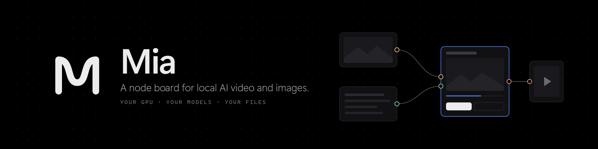
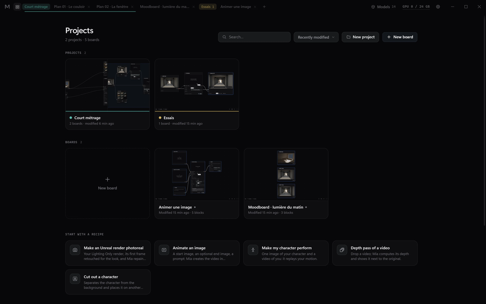
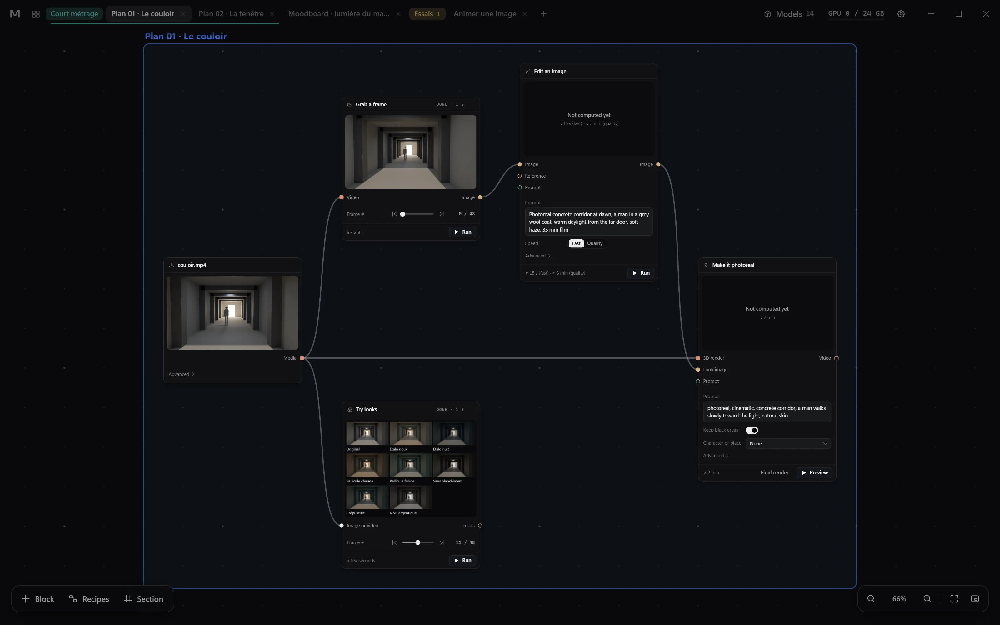
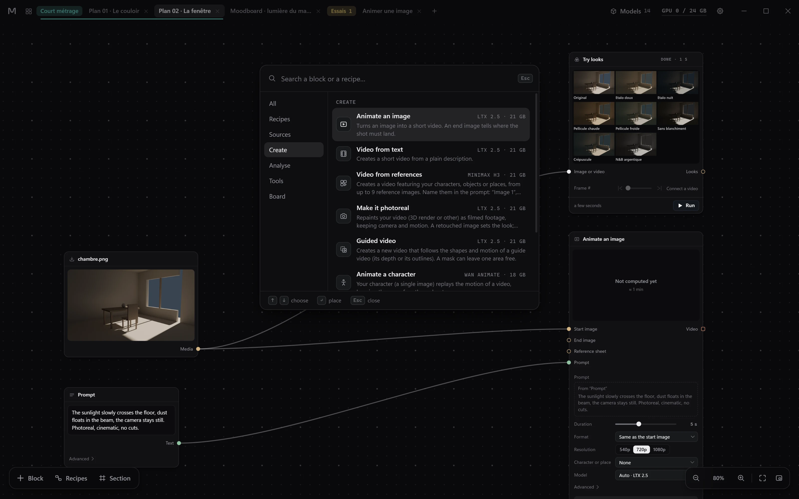
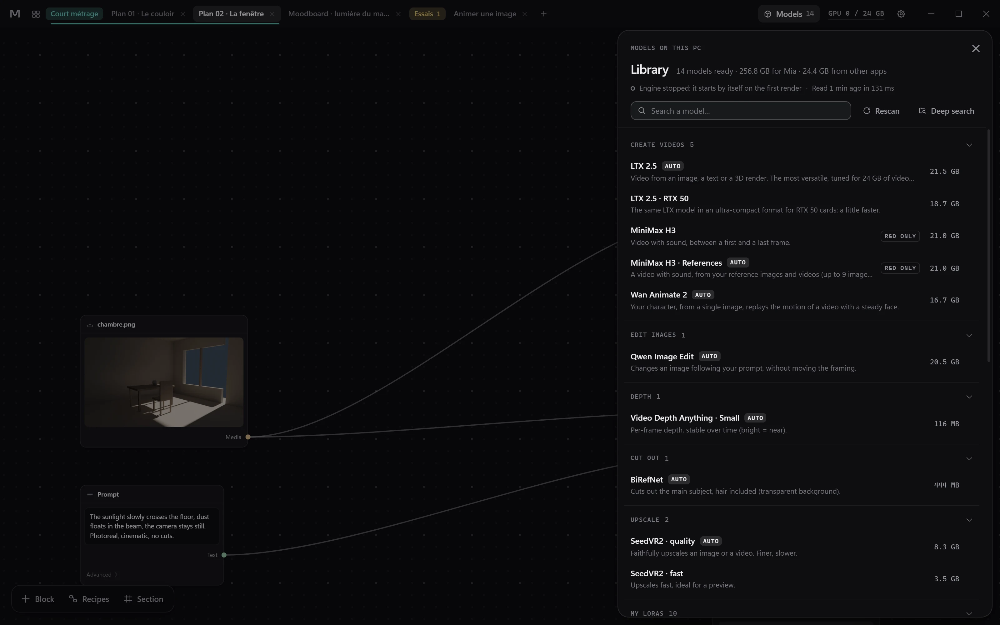
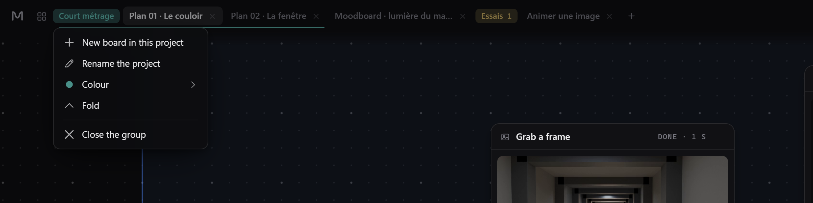

<div align="center">
  
</div>

<div align="center">

[](CHANGELOG.md)
[](LICENSE)
[](https://www.electronjs.org/)
[](docs/INSTALL.md)
[](docs/INSTALL.md)

</div>

**Mia is a node board for AI video and images that runs entirely on your own PC.** Drop images, videos and
sounds on an infinite black board, wire them to blocks named by what they do (*Animate an image*, *Depth*,
*Make it photoreal*), pick a model, run, and watch the result play inside the block. No account, no graph of
sixty nodes: Mia drives ComfyUI and a small Python worker for you, one GPU job at a time. Online models are there
too, only if you link your own account.

**[Install](docs/INSTALL.md)** · **[Changelog](CHANGELOG.md)** · **[Architecture](docs/ARCHITECTURE.md)** ·
**[Assistants (MCP)](mcp/README.md)** · **[Skills](skills/README.md)** · **[Français](README.fr.md)**

<div align="center">
  
</div>
<p align="center"><em>Claude builds the shot through Mia's MCP server, in front of you: a 3D blockout and its retouched first frame, <b>Make it photoreal</b>, wired and run, then a before/after wipe. The one-minute preview is shortened here.</em></p>

### New in 0.6

<div align="center">
  <a href="CHANGELOG.md"></a>
</div>
<p align="center"><em>Projects hold boards; the tabs of a project stay together, with its colour, like tab groups in Chrome.</em></p>

- **One block per model**: LTX, MiniMax, Wan, Qwen, FLUX.2 Klein… each in a **Model** block that only has the
  inputs its model takes. What you wire decides what it does: a start image, it animates it; references, it mixes
  them; nothing, it starts from the text.
- **Online models, if you want them**: Seedance, Kling, MiniMax 2K and more through your own Higgsfield account
  (the key stays encrypted on your PC). Each job costs credits and only leaves on your click.
- **Images on your PC**: FLUX.2 Klein 9B and Qwen-Image 2.1 Turbo (non-commercial licences, offered *to try*). A
  **Layout** input keeps a composition while your LoRA keeps its style.
- **Retouch a zone**: paint the zone in a **Mask** block; only that zone is remade, the rest of the image stays
  identical to the pixel. A small zone (feet, an eye) is enlarged on its own.
- **Rewrite in English**: a Prompt block can have its text fixed and translated by a model on your PC before the
  job, and shows what was understood.
- **4 variations**: one click makes four images with four seeds; star the one you keep.
- And: **+ Block** sorted by what you make, keyframes (LTX, MiniMax), extend a video and a sound to follow
  (MiniMax), tooltips on every input. From 0.5: the installer and portable zip, models installed from the library.

[What it does](#what-it-does) · [Blocks](#blocks) · [Models](#models) · [Install](#install) · [Use](#use) ·
[Assistants](#assistants) · [Licence and credits](#licence-and-credits)

---

## What it does

<div align="center">
  
</div>
<p align="center"><em>One shot in a section: a 3D blockout, its first frame grabbed and retouched into the look, <b>Make it photoreal</b> ready for a preview, and every Finish look tried on one frame. Videos play in their block, frame by frame.</em></p>

Mia is for people who make films and images with local AI models and want to think in shots, not in graphs.

- **A board, not a graph editor.** Blocks are named by what they do, advanced settings stay folded, wires land
  exactly on their ports, sections frame a shot. Mouse and trackpad, minimap, nothing of Windows in sight.
- **Preview, then final render.** Every run is a version of its block; star one to pin it downstream. A block
  whose settings or inputs changed shows it is out of date, and running a block re-runs only what changed upstream.
- **One heavy job at a time.** A single queue and a GPU lock shared with other tools on the machine; the ETA
  is learnt from your own runs ("done around 20:45").
- **A frame-accurate player** in every video block: frame counter, step by one or ten frames, speed, grab a frame
  into a new block.
- **Your LoRAs**: drop a `.safetensors` on Mia, name it, set its strength; its trigger word is added for you.
- **Assistants on the board**: Claude or Codex can build a board through Mia's MCP server while you watch
  their cursor place and wire blocks. Every action can be undone.
- **Local first.** Mia listens on `127.0.0.1` only. It goes online only for the model downloads you start and,
  if you link a Higgsfield account, for the online jobs you run and to show what the account spent.

<div align="center">
  
</div>
<p align="center"><em>Add a block (<b>Tab</b>), drag one wire, write the prompt, preview: the grey blockout becomes a sunlit room. The 31-second edit is shortened here.</em></p>

<div align="center">
  
</div>
<p align="center"><em>The player in every video block: play, pause, step one frame at a time, frames or seconds, then <b>Grab a frame</b> turns that frame into an image block.</em></p>

<div align="center">
  
</div>
<p align="center"><em>The palette: categories, search, and the model each block will use.</em></p>

<div align="center">
  
</div>
<p align="center"><em>The library: the models found on this PC, described by what they can do, with their size and licence flag.</em></p>

<div align="center">
  
</div>
<p align="center"><em><b>Try looks</b> runs one frame through every film look; in <b>Finish › Grade</b> each look you pick becomes a new version of the block.</em></p>

<div align="center">
  
</div>
<p align="center"><em>Tab groups: a project's colour, its menu, and a folded project on the right.</em></p>

The screenshots and animations use plain 3D blockouts rendered for this page; the results are real previews computed by Mia on one GPU.

---

## Blocks

| Category | Block | What it does | Runs on |
|---|---|---|---|
| Sources | **Media** | An image, a video or a sound from your PC | — |
| | **Prompt** | A text telling the AI what to show or do | — |
| Board | **Note** | A note to yourself on the board | — |
| Create | **Model** | One block per model, on this PC or online: its inputs are the model's, what you wire decides what it does (video, image, retouch a zone…) | GPU, or online |
| | **Animate an image** | An image becomes a short video; an end image tells where the shot must land | GPU |
| | **Video from text** | A short video from a plain description | GPU |
| | **Video from references** | A video with your characters, objects or places, from up to 9 reference images | GPU |
| | **Make it photoreal** | Repaints a 3D render as filmed footage, keeping camera and motion | GPU |
| | **Guided video** | A new video that follows the depth or outlines of a guide video | GPU |
| | **Animate a character** | Your character, from one image, replays the motion of a video | GPU |
| | **Edit an image** | Changes an image following your prompt, framing kept | GPU |
| | **Upscale** | Higher resolution with recreated detail, motion untouched | GPU |
| Analyse | **Depth** | Per-frame depth without flicker (bright = near) | GPU |
| | **Cut out** | Separates the main subject from the background | GPU |
| Tools | **Mask** | Paint on an image the zone to change (or to protect) | CPU |
| | **Compare A/B** | Two images or videos side by side, played in sync | — |
| | **Grab a frame** | One exact frame from a video | instant |
| | **Trim** · **Resize** · **Join clips** | Cut, reframe, put clips end to end in wire order | NVENC, else CPU |
| | **Composite** | A layer over a background, through a mask | GPU |
| | **Sound** | Adds music or an effect, mixed with the original sound or instead of it | NVENC, else CPU |
| | **Finish** | LUT grade, grain and vignette, sound kept | GPU |
| | **Try looks** | One frame through every Finish look, as a contact sheet | CPU |
| | **Export** | Saves the result into the board's review folder, in the right format | NVENC, else CPU |

Seven **recipes** start a board already wired: *Make an Unreal render photoreal*, *Animate an image*,
*Video from my references*, *Make my character perform*, *Depth pass of a video*, *Retouch a zone*, *Cut out a
character*. A **Prompt** block can rewrite its text in English on your PC first (*Rewrite in English*). The
catalogue lives in [`src/catalog/nodes.json`](src/catalog/nodes.json).

---

## Models

Mia ships **no model**. It scans the engine folder, recognises what is there and explains it by capability;
what is missing can be installed from the library.

| Capability | Model Mia uses | Licence (as flagged in Mia) | VRAM peak |
|---|---|---|---|
| Animate an image, video from text, make it photoreal, guided video | LTX 2.5 (int8; NVFP4 on RTX 50) | [LTX-2.x Community License](docs/licenses/LTX-2.x-Community-License.txt): free commercial use under USD 10 M revenue | ~21 GB |
| Animate an image (with sound), video from references, guided video | MiniMax H3, MiniMax H3 References | R&D only | ~21 GB |
| Animate a character | Wan Animate 2 | Apache-2.0 | ~18 GB |
| Edit an image | Qwen Image Edit | Apache-2.0 | ~21 GB |
| Image from text, retouch a zone | FLUX.2 Klein 9B · Qwen-Image 2.1 Turbo | FLUX Non-Commercial · Qwen research licence: offered *to try*, for trials and personal projects | ~22 / ~17 GB |
| Rewrite a prompt in English | the text reader of Qwen-Image 2.1 (Qwen3-VL 8B), else that of Qwen Image Edit | as its model | ~10 GB |
| Upscale | SeedVR2 7B (quality), 3B (fast) | Apache-2.0 | 12 / 7 GB |
| Depth | Video Depth Anything Small | Apache-2.0 | ~3 GB |
| Cut out | BiRefNet | MIT | ~2 GB |
| Character or place | Your LoRAs for LTX, Wan, Qwen, FLUX.2 Klein or Qwen-Image 2.1 | yours | — |
| Online, optional | Seedance, Kling, MiniMax 2K, Soul… through your Higgsfield account | their terms, paid per job | none |

The two IC-LoRAs used for guided video and for reference sheets (Union-Control, Ingredients) are LTX-2.3 files,
under the [LTX-2 Community License](docs/licenses/LTX-2-Community-License.txt) of January 2026, with the same
USD 10 M threshold.

MiniMax H3 is offered with its **R&D only** flag. Models whose licence is non-commercial or excludes the European
Union are recognised but **never offered** in a block, except FLUX.2 Klein 9B and Qwen-Image 2.1: they are offered
*to try*, with a non-commercial warning on the block. The flags above are a convenience, not legal advice: read
each model card before paid work.

---

## Install

**You need** Windows 10 or 11 (64-bit); an NVIDIA GPU with a driver 580 or newer, with 12 GB of memory for depth,
cut-out and the fast upscale, and 24 GB for the video models and image editing; about 15 GB of disk for the engine
plus 20 to 150 GB for models; Internet during installation only. The full walk-through, in French, is
[docs/INSTALL.md](docs/INSTALL.md).

1. **Mia.** Take the installer or the portable zip from the Releases page, or run it from source:

   ```powershell
   git clone https://github.com/Quentincls/mia.git
   cd mia
   npm install
   npm start
   ```

   The builds are not code-signed yet: SmartScreen will ask for confirmation the first time.

2. **The engine.** On first launch, the wizard offers to use a ComfyUI you already have or to install Mia's own
   engine in a folder of your choice. The same script can be run by hand; `-DryRun` shows every step without
   downloading anything:

   ```powershell
   powershell -NoProfile -ExecutionPolicy Bypass -File engine-setup\install-engine.ps1 -Target "D:\Mia-engine" -DryRun
   ```

3. **The models.** Open the library (**Models**, top right), then **Install** next to a missing model, or
   **Install everything for** a capability. For a gated model, accept its licence on Hugging Face and run
   `hf auth login` once; Mia reads that token, never stores it.

---

## Use

1. **New board** (Ctrl+N), or start from a recipe on the home page.
2. **Drop** images, videos or sounds on the board. A LoRA file dropped anywhere opens *Add a LoRA*.
3. **Add a block** with **Tab** (or the **+ Block** button) and wire an output to an input.
4. **Preview** first, then **Final render**. The result appears in the block; older runs stay as versions.
5. **Export** writes the final file into the board's review folder (`A_regarder`).

| Keys | Action |
|---|---|
| Wheel · pinch | Zoom at the cursor |
| Middle drag · Space + drag · two fingers | Pan |
| Tab | Add a block |
| S · Ctrl+G | Draw a section · section around the selection |
| F · M | Fit · minimap |
| Ctrl+Z · Ctrl+Y | Undo · redo |
| ← → · Shift+← → | Previous / next frame · ten frames |
| , . | Slower · faster |
| Ctrl+N · Ctrl+Shift+N | New board · new project |
| Ctrl+Tab · Ctrl+W | Next tab · close tab |

Boards live in `D:\Mia\Projets` when a D: drive exists, otherwise in `Documents\Mia Projets` (change it in
Settings). Each board is a plain folder: `graph.json`, `media\` (your originals, never recompressed),
`outputs\<block>\<run>\` (every result with its `run.json`), `A_regarder\` (exports).

---

## Assistants

Mia includes a dependency-free MCP server, [`mcp/mia-mcp.js`](mcp/mia-mcp.js), with 24 tools
(`mia_create_project`, `mia_add_block`, `mia_connect`, `mia_run`, `mia_snapshot`…). It talks to Mia through a
local bridge (`127.0.0.1`, random token) and starts Mia if it is closed. Declare it once, with Node.js installed:

```json
{ "mcpServers": { "mia": { "command": "node", "args": ["C:\\path\\to\\Mia\\mcp\\mia-mcp.js"] } } }
```

Without Node.js, Mia's own executable runs it: put it in `"command"` (`%LOCALAPPDATA%\Programs\Mia\Mia.exe` with
the installer, `node_modules\electron\dist\electron.exe` from source) and add `"env": { "ELECTRON_RUN_AS_NODE": "1" }`.

With the installer, the server is `%LOCALAPPDATA%\Programs\Mia\resources\app\mcp\mia-mcp.js` (written out in full
in the JSON, see [mcp/README.md](mcp/README.md)). For Codex, the same in `~/.codex/config.toml` under
`[mcp_servers.mia]`. The [skills](skills/README.md) teach an assistant how to drive Mia and which recipes work for
which shot.

---

## Licence and credits

Mia's code is released under the **Apache License 2.0** ([LICENSE](LICENSE), [NOTICE](NOTICE)). Third-party
software keeps its own licence and is not copied into this repository, except eleven ComfyUI graphs derived from
published examples: these data files keep the licence of their source ([NOTICE](NOTICE),
[docs/licenses](docs/licenses)); their sources and every change made for Mia are listed in
[electron/engine/workflows/NOTICE.md](electron/engine/workflows/NOTICE.md).

| Part | Origin | Licence | How Mia uses it |
|---|---|---|---|
| Mia: app, worker, MCP server, LUTs, logo | this repository | Apache-2.0 | — |
| `python/vendor/tool` | frozen copy of the author's own tools | Apache-2.0 | imported by the worker |
| 2 ComfyUI graphs (`depth_vda`, `seedvr2_node`) | written for Mia | Apache-2.0 | sent to ComfyUI by the executors |
| 7 ComfyUI graphs (`minimax_i2v`, `minimax_r2v`, `qwen_edit_2511`, `wan_animate2`, `flux2_klein9b_t2i`, `flux2_klein9b_edit`, `qwen_image21_t2i`) | derived from [Comfy-Org/workflow_templates](https://github.com/Comfy-Org/workflow_templates) | [MIT](docs/licenses/Comfy-Org-workflow_templates-MIT.txt) | sent to ComfyUI by the executors |
| 3 ComfyUI graphs (`ltx_i2v`, `ltx_t2v`, `ltx_layout_single`) | derived from Lightricks' LTX-2.5 examples ([ComfyUI-LTXVideo](https://github.com/Lightricks/ComfyUI-LTXVideo), [Layout-To-Render](https://huggingface.co/Lightricks/LTX-2.5-22b-IC-LoRA-Layout-To-Render)) | [LTX-2.x Community License](docs/licenses/LTX-2.x-Community-License.txt); `ltx_i2v` and `ltx_t2v` also [LTX-2 Community License](docs/licenses/LTX-2-Community-License.txt) | sent to ComfyUI by the executors |
| 1 ComfyUI graph (`seedvr2_native`) | derived from a blueprint shipped with [ComfyUI](https://github.com/comfyanonymous/ComfyUI) | [GPL-3.0](docs/licenses/GPL-3.0.txt) | sent to ComfyUI by the executors |
| [Electron](https://www.electronjs.org/) | OpenJS Foundation | MIT | runtime, bundled in builds |
| [electron-builder](https://www.electron.build/) | electron-userland | MIT | build only |
| [uv](https://github.com/astral-sh/uv) | Astral | MIT or Apache-2.0 | installed by the engine script |
| [CPython](https://www.python.org/) | Python Software Foundation | PSF License | installed by uv for the engine |
| [ComfyUI](https://github.com/comfyanonymous/ComfyUI) | comfyanonymous | GPL-3.0 | installed by the engine script, driven over local HTTP |
| [ComfyUI-LTXVideo](https://github.com/Lightricks/ComfyUI-LTXVideo) | Lightricks | [LTX-2 Community License](docs/licenses/LTX-2-Community-License.txt) | installed by the engine script |
| [ComfyUI-Video-Depth-Anything](https://github.com/yuvraj108c/ComfyUI-Video-Depth-Anything) | yuvraj108c | Apache-2.0 | installed by the engine script |
| [ComfyUI-SeedVR2_VideoUpscaler](https://github.com/numz/ComfyUI-SeedVR2_VideoUpscaler) | numz | Apache-2.0 | installed by the engine script |
| [PyTorch](https://pytorch.org/) · [PyAV](https://github.com/PyAV-Org/PyAV) | PyTorch Foundation · PyAV | BSD-3-Clause | installed by the engine script |
| [FFmpeg](https://ffmpeg.org/) via [imageio-ffmpeg](https://github.com/imageio/imageio-ffmpeg) | FFmpeg · imageio | LGPL / GPL · BSD-2-Clause | installed by the engine script |
| Models | see [Models](#models) | each its own | downloaded by you, never shipped |

The interface fonts (Segoe UI Variable, Cascadia Mono) come with Windows and are not distributed.

---

Mia was built for one person's way of working: a 3D artist making short films with local models on a single GPU,
who wanted the power of ComfyUI without its wiring. It is shared as is, in case it helps someone else. Its
interface speaks French and English; most of the documentation is in French for now.
Its sibling, [LocalMesh Engine](https://github.com/Quentincls/localmesh-engine), turns photos into 3D meshes,
locally too.

---
